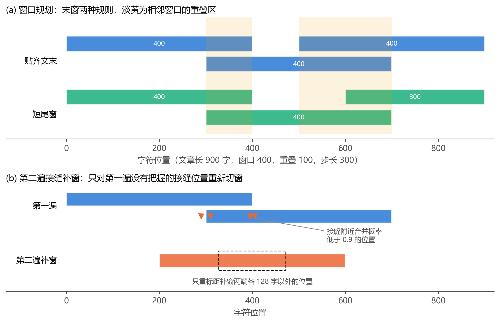
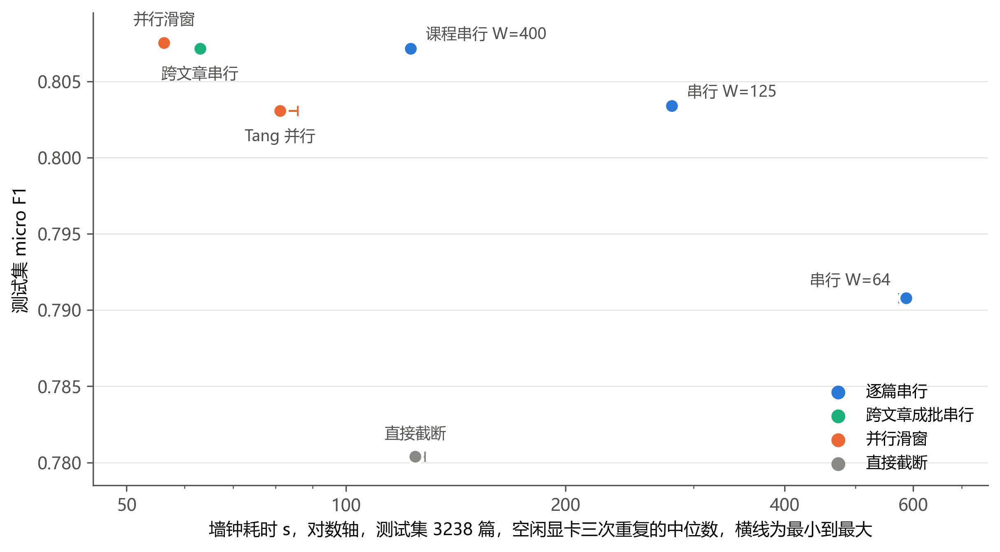
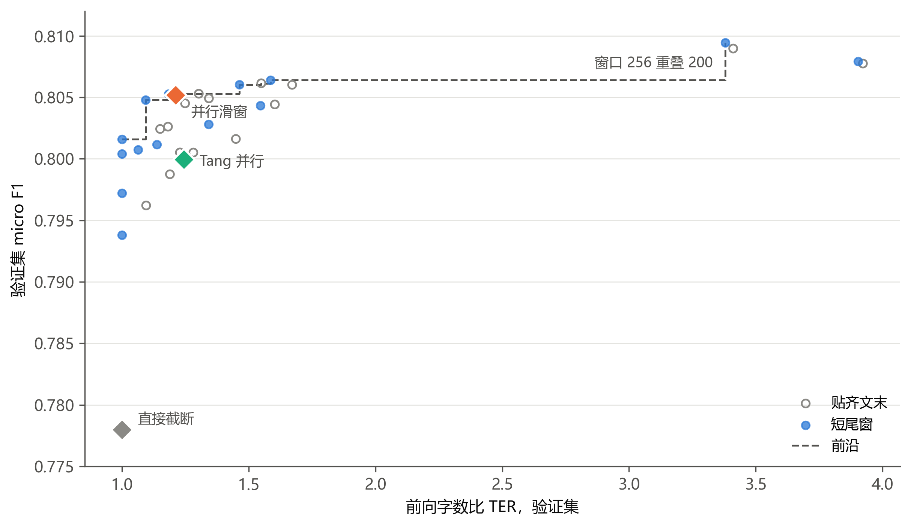
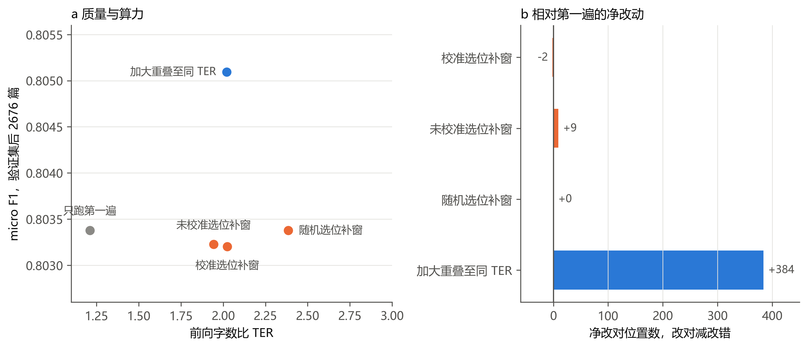

# 接缝感知的并行滑窗 BERT 断句标点

[](https://github.com/rain-xhy/seam-aware-bert-punctuation)
[](https://www.python.org/)
[](https://pytorch.org/)
[](https://github.com/huggingface/transformers)

基于 bert-base-chinese 的中文逐字标点恢复研究。长文本必须切成窗口才能送入编码器，串行滑窗让下一窗的起点依赖上一窗的输出，并行滑窗按固定步长预先划好全部窗口，可以跨文章成批前向。本项目在同一个微调模型、同一份数据上比较七种解码方法，并检验重叠大小、尾窗规则和第二遍接缝补窗各自的作用，实验全部在一块 4096 MiB 显存的笔记本显卡上完成。

## 📊 核心发现

- **并行不劣于串行**：窗口 400、重叠 100、短尾窗的并行滑窗，测试集 micro F1 **0.8075**，课程串行规则 **0.8072**。验证集后 2676 篇做配对自助检验，差值 **+0.0005**，95% 区间 [−0.0004, +0.0014]，落在非劣性容差 0.002 之内
- **速度取决于拿谁比**：空闲显卡三次计时取中位数，并行滑窗 **56.3 秒**，是逐篇串行（课程规则）的 **2.18 倍**，但相对同样跨文章成批的串行只有 **1.12 倍**，速度优势主要来自窗口成批
- **短尾窗省算力**：窗口 400 与 510、重叠 0 到 200 的八种设置中，前向字数降低 **5.1% 到 15.9%**，F1 变化不超过 **0.0015**
- **第二遍补窗是负结果**：校准选位补窗 F1 **0.8032**，低于只跑第一遍的 0.8034，也低于前向字数相同而改为加大重叠的 **0.8051**，后一差值 −0.0019，区间 [−0.0028, −0.0009]
- **边缘感知训练的效应分不出训练波动**：关闭后并行解码的测试 F1 为 0.8090，比主模型高 0.0015，同配置再训练一次也高 0.0013，两个区间都含 0
- **标签不逐位一致**：bf16 下批大小不同，或 bf16 与 fp32 之间，16 万个位置中有 **6 到 27 处**标签不同，一致率不低于 99.98%
- **长文本**：10 万字的合成文本切成 333 个窗口，OOM 重试 0 次，峰值显存 655 MiB

## 🗂️ 项目结构

```
seam-aware-bert-punctuation/
├── punct/                    # 核心库
│   ├── window_plan.py        # 窗口规划，贴齐与短尾两种末窗规则
│   ├── engine.py             # 批量解码引擎，显存回退、显卡上累加、一次回传
│   ├── merge.py              # 重叠区合并权重
│   ├── infer_serial.py       # 串行规则，俞敬松、Tang、课程规则与跨文章串行
│   ├── tang_parallel.py      # Tang 并行滑窗
│   ├── edep.py / edep_scan.py   # 边缘距离误差剖面
│   ├── two_pass.py           # 第二遍接缝补窗
│   ├── pipeline.py           # 流水线形式的两遍解码
│   ├── calibrate.py          # 温度与类别偏置校准
│   ├── metrics.py            # P/R/F1、接缝 F1、误差分解
│   ├── bootstrap.py          # 按文章配对的自助重采样与非劣性检验
│   └── runner.py             # 加载数据、运行方法、打分
├── scripts/                  # 实验脚本，每个对应一项实验
├── tests/                    # 单元测试，203 个
├── figures/paper/            # 论文图 1 至图 6
├── train.py                  # 训练，变长随机裁剪与边缘感知截断
├── prepare_complete_data.py  # 语料转数据集
├── run_eval_queue.py         # 评估队列
├── run_control_eval.py       # 对照模型的测试集评估
├── run_gpu_when_idle.py      # GPU 空闲后再运行的计时守护脚本
├── run_timing_repeat.py      # 三次重复计时
├── PLAN_COMPLIANCE.md        # 方案执行情况对照
├── CONTROL_MODEL_MAPPING.md  # 对照模型编号与实际目录
└── requirements.txt
```

`punct/inference.py`、`punct/infer_parallel.py`、`punct/seam_refine.py` 和根目录的 `run_inference.py` 是早期的单文本推理代码，论文里的实验不经过它们。

## 🚀 快速开始

### 环境要求

- Python 3.8+
- PyTorch 2.4.1，CUDA 12.4
- transformers 4.46.3，numpy 1.24.x
- 实验在一块 4096 MiB 显存的 RTX 3050 笔记本显卡上完成

### 安装

```bash
git clone https://github.com/rain-xhy/seam-aware-bert-punctuation.git
cd seam-aware-bert-punctuation
pip install -r requirements.txt

# bert-base-chinese 需要自行下载到项目根目录，仓库不含权重
# 语料不随仓库发布，见下文数据集一节
```

### 准备数据

```bash
python prepare_complete_data.py
```

脚本里的语料目录和输出目录写死为作者本机路径，使用前需要改 `CORPUS_DIR` 与 `OUT_DIR`。输出在 `prepared_data_complete/`。

### 训练

```bash
python train.py --data_dir prepared_data_complete --out_dir checkpoints/T1_varlen \
    --bert_dir bert-base-chinese --epochs 3 --batch_size 1 --grad_accum 8 \
    --max_len 400 --seed 42
```

四个对照模型只改下面的参数，其余与上面相同。

| 目录 | 参数 | 含义 |
|---|---|---|
| T3_noedge | `--max_len 400 --edge_aware_prob 0` | 关闭边缘感知截断 |
| T2_center_only | `--max_len 400 --center_only` | 只监督窗口中心区 |
| T4_fixed256 | `--min_len 256 --max_len 256` | 固定长度 256 |
| T5_no_class_weight | 与 T1 相同 | 同配置再训练一次，用来看训练波动 |

训练每 4000 个微批保存 `resume.pt`，中断后重新运行同一条命令会自动续训。

### 评估

```bash
# 七种解码方法，测试集
python -m scripts.run_methods --ckpt checkpoints/T1_varlen/best.pt --split test \
    --methods direct_cut serial_yu serial_tang serial_teacher serial_cross parallel tang_parallel \
    --batch_size 4 --out results/E4_test.json --save_preds results/E4_test_preds.npz

# 窗口、重叠、尾窗扫描，同时输出边缘距离误差剖面
python -m scripts.run_sweep --ckpt checkpoints/T1_varlen/best.pt --split dev \
    --windows 128 256 400 510 --overlaps 0 50 100 200 --tails short aligned \
    --edep --out results/E3_dev.json

# 训练长度与推理窗口
python -m scripts.run_matrix --models T1_varlen=checkpoints/T1_varlen/best.pt \
    T4_fixed256=checkpoints/T4_fixed256/best.pt --split dev --windows 64 125 400 510 \
    --out results/E8_matrix.json

# 全部评估实验按顺序排队运行
python run_eval_queue.py
```

速度和精度检查需要独占显卡。`run_gpu_when_idle.py` 会等显卡连续空闲 20 分钟，再依次运行精度检查和三次计时。

```bash
python -m scripts.verify_precision --ckpt checkpoints/T1_varlen/best.pt --split test \
    --limit 300 --out results/precision_consistency.json
python run_timing_repeat.py        # 结果在 results/timing/
python -m scripts.recompute --result results/E4_dev.json \
    --preds results/E4_dev_preds.npz --data_dir prepared_data_complete
python -m unittest discover -s tests   # 203 个测试
```

`run_eval_queue.py`、`run_timing_repeat.py`、`run_gpu_when_idle.py` 等队列脚本里的 `PYTHON` 常量是作者本机的解释器路径，使用前改成自己的。

## 📈 实验清单

| 编号 | 名称 | 核心发现 |
|------|------|---------|
| E3 | 窗口、重叠与尾窗扫描 | 30 个配置，整体 F1 最高 0.8095（窗口 256、重叠 200，TER 3.380）；短尾窗使 TER 降低 5.1% 到 15.9% |
| E4 | 七种解码方法对比 | 并行滑窗 0.8075，课程串行 0.8072，直接截断 0.7804 |
| E5 | 重叠区合并权重 | 硬屏蔽、高斯、经验权重和直接平均相差不超过 0.0001 |
| E7 | 第二遍补窗与三个对照 | 补窗不优于只跑第一遍，且差于同 TER 加大重叠 |
| E8 | 训练长度与推理窗口 | 变长训练在四个推理窗口上都高于固定长度 256 |
| H1 到 H3 | 三个预先设定的假设 | H1 非劣成立，H2 和 H3 的优于不成立 |
| 固定核心 | 把接缝与窗口边缘分开 | 每侧补 14 个字接缝 F1 回升 0.0678，补到 63 个字只再升约 0.007 |
| 批大小探测 | 批大小 1 到 32 的吞吐与显存 | 吞吐来自可能有其他进程占用显卡的运行，未重测，不引用 |
| 精度与批次 | bf16 对 fp32、不同批大小 | 16 万个位置中有 6 到 27 处标签不同 |
| 长文本 | 10 万字合成文本 | 333 个窗口，OOM 重试 0 次，峰值显存 655 MiB |
| 空闲显卡计时 | 七种方法各三次 | 并行滑窗 56.3 秒，课程串行 122.6 秒，跨文章串行 63.1 秒 |

## 📊 主要结果

### 七种解码方法

测试集 3238 篇，T1 主模型，批大小 4，bf16。耗时为 GPU 空闲时三次重复的中位数，加速比以课程串行 `serial_teacher` 为基准。

| 方法 | 窗口 | F1 | 耗时 s | 字/秒 | 相对课程串行 | 相对跨文章串行 |
|---|---|---|---|---|---|---|
| direct_cut | 64，不重叠 | 0.7804 | 124.4 | 15211 | 0.99 | 0.51 |
| serial_yu | 64 | 0.7908 | 586.6 | 3227 | 0.21 | 0.11 |
| serial_tang | 125 | 0.8034 | 279.7 | 6767 | 0.44 | 0.23 |
| serial_teacher | 400 | 0.8072 | 122.6 | 15435 | 1.00 | 0.51 |
| serial_cross | 400 | 0.8072 | 63.1 | 30011 | 1.94 | 1.00 |
| **parallel** | 400，重叠 100，短尾 | **0.8075** | **56.3** | **33642** | **2.18** | **1.12** |
| tang_parallel | 125，重叠 20 | 0.8031 | 81.1 | 23326 | 1.51 | 0.78 |

并行滑窗比逐篇处理的串行方法快 2.18 倍到 10.4 倍，但只比同样跨文章成批的串行快 1.12 倍，速度优势主要来自把窗口放进同一个批次。在验证集后 2676 篇上，并行滑窗减课程串行的配对差值为 +0.0005，95% 区间 [−0.0004, +0.0014]，下界高于非劣性界 −0.002，非劣成立。

### 短尾窗

验证集，T1。短尾窗不再把末窗回拉到文末，末窗之前的部分不被重复计算，前向字数比 TER 下降，重叠不小于 50 时 F1 不降。

| 窗口 | 重叠 | TER 贴齐 | TER 短尾 | 下降 | F1 变化 |
|---|---|---|---|---|---|
| 400 | 0 | 1.181 | 1.000 | 15.4% | −0.0010 |
| 400 | 50 | 1.249 | 1.094 | 12.4% | +0.0003 |
| 400 | 100 | 1.343 | 1.211 | 9.8% | +0.0003 |
| 400 | 200 | 1.671 | 1.586 | 5.1% | +0.0004 |
| 510 | 0 | 1.189 | 1.000 | 15.9% | −0.0015 |
| 510 | 50 | 1.228 | 1.064 | 13.4% | +0.0002 |
| 510 | 100 | 1.281 | 1.138 | 11.2% | +0.0006 |
| 510 | 200 | 1.449 | 1.341 | 7.4% | +0.0012 |

### 第二遍补窗

验证集去掉前 500 篇校准文章后的 2676 篇，第一遍为窗口 400、重叠 100、短尾窗。加大重叠一行的重叠值为 259，使第一遍的 TER 与校准选位补窗的总 TER 最接近。

| 配置 | F1 | TER | 选中位置 | 标签改动 | 错改对 | 对改错 |
|---|---|---|---|---|---|---|
| 只跑第一遍 | 0.8034 | 1.210 | 0 | 0 | 0 | 0 |
| 校准选位补窗 | 0.8032 | 2.024 | 9453 | 1018 | 455 | 457 |
| 未校准选位补窗 | 0.8032 | 1.943 | 6682 | 997 | 452 | 443 |
| 随机选位补窗 | 0.8034 | 2.385 | 9453 | 50 | 20 | 20 |
| 加大重叠至 259 | 0.8051 | 2.021 | 不适用 | 6595 | 3202 | 2818 |

标签改动指与第一遍标签不同的位置数，错改对指第一遍错、补窗后对，对改错指第一遍对、补窗后错。校准选位补窗改动的 1018 个位置里，改对与改错几乎相等。

### 预先设定的假设

验证集后 2676 篇，1000 次按文章配对的自助重采样，95% 区间，非劣性容差 0.002。

| 假设 | 差值 | 95% 区间 | 结论 |
|---|---|---|---|
| H1 并行减课程串行 | +0.0005 | −0.0004 至 +0.0014 | 非劣成立 |
| H2 校准补窗减同 TER 加大重叠 | −0.0019 | −0.0028 至 −0.0009 | 优于不成立，补窗显著更差 |
| H3 校准补窗减随机补窗 | −0.0002 | −0.0005 至 +0.0002 | 优于不成立，无可检出差别 |
| 探索性 校准补窗减只跑第一遍 | −0.0002 | −0.0005 至 +0.0002 | 区间含 0 |

### 图表









更多图表见 [figures/paper/](./figures/paper/)


## 🔬 方法概览

### 1. 并行滑窗与短尾窗

窗口大小 W，重叠 V，步长 S = W − V。窗口起点只由文章长度决定，与模型输出无关，全部窗口可以先规划好，跨文章放进同一个池，按长度排序后分批前向。

最后一个窗口有两种规则。贴齐把末窗回拉到文末，长度保持 W，但与前一窗的重叠变大。短尾让末窗从前一窗起点加 S 处开始，长度不足 W 也不补齐，文末之前的部分不再重复计算。

### 2. 重叠区合并与边缘距离误差剖面

同一位置被多个窗口覆盖时，对各窗口给出的概率向量加权平均再取最大类别，累加在显卡上用 `index_add_` 完成，标签一次传回。权重有硬屏蔽、高斯和经验三种。

边缘距离误差剖面按每个位置到窗口左边缘或右边缘的距离分别统计错误率，得到 EDEP-L 与 EDEP-R 两条曲线，读出左右两端各应屏蔽多宽。读数对平滑和容差敏感，本文只在窗口 400、重叠 100 上比较了一组硬屏蔽宽度与不屏蔽，F1 之差不超过 0.0001，没有给出经过检验的非对称屏蔽结论。

### 3. 边缘感知训练

训练样本从文章字符流中随机取起点，长度 L 在 32 到 400 之间均匀抽取，使模型见过从句子中间开始、在句子中间结束的片段。每个样本以 0.3 的概率把右端再截短，让模型更多见到右侧上下文稀缺的位置。优化器 AdamW，学习率 3e-5，权重衰减 0.01，前 10% 步数预热，bf16，微批 1 梯度累积 8，共 3 轮。

### 4. 第二遍补窗

第一遍用较小的重叠完成合并，之后取距窗口内部边缘不超过 16 个字、合并概率最大分量低于 0.9 的位置，用长度 400 的补窗重新标注，补窗只重新标注距自己两端都不少于 128 个字的位置。选位所用概率先经过温度加类别偏置校准，校准参数在验证集前 500 篇上拟合，温度 1.4579，期望校准误差从 0.0081 降到 0.0015。

## 📚 数据集

**来源**：北京大学计算语言学研究所 1998 年人民日报标注语料库 2003 版上半年部分，六个月份文件，编码 GB18030。语料不随仓库发布。

**标签**：每个字后面紧跟的停顿标点，共八类，依次为无标点、逗号、句号、问号、叹号、分号、冒号、顿号。句号、问号和叹号合称句末标点。

**划分**：按月份，文章层面互不相交。

| 集合 | 月份 | 文章数 | 字数 |
|---|---|---|---|
| 训练集 | 1 至 4 月 | 11951 | 7245417 |
| 验证集 | 5 月 | 3176 | 1876001 |
| 测试集 | 6 月 | 3238 | 1892857 |

**清洗说明**：实际使用的数据由简化的清洗脚本生成，BERT 词表查不到的字映射为 `[UNK]`，在三个集合中分别占 0.96%、0.92% 和 0.88%，按最初规则清洗约为 0.016%。验证集上 `[UNK]` 位置的 F1 为 0.7346，其余位置为 0.8046，即使前者提到后者的水平，整体 F1 也只上升约 0.1 个百分点，这是按位置数加权的估算，没有重新训练验证。所有模型和方法使用同一份数据，方法间比较不受影响，但绝对 F1 不能与按完整规则清洗的数字直接比较。

## ⚠️ 局限

- 每种训练设置只有一个随机种子，边缘感知训练的效应与训练波动分不开
- 并行滑窗相对跨文章成批的串行只快 1.12 倍，该串行实现固定按每批 8 个窗口前向，与并行滑窗的计时批大小不同，没有在相同批大小下重测
- 串行方法没有记录前向字数，TER 图中不出现串行点
- 屏蔽宽度的剖面读数对平滑和容差敏感，没有系统比较多组候选宽度
- 流水线形式的两遍解码只在替身模型上验证了与标准形式逐位相同，真实模型上没有检验，延迟收益没有测量
- 语料只有 1998 年上半年的人民日报，文体单一，没有跨语料检验
- 实验只在一块 4096 MiB 的笔记本显卡上完成


## 📄 引用

```bibtex
@misc{han2026seam,
  author = {Han, Yu},
  title = {Seam-Aware Parallel Sliding-Window BERT for Chinese Punctuation Restoration},
  year = {2026},
  publisher = {GitHub},
  url = {https://github.com/rain-xhy/seam-aware-bert-punctuation}
}
```

## 🤝 致谢

- 北京大学软件与微电子学院俞老师提供的学术指导
- 北京大学计算语言学研究所发布的人民日报标注语料库

## 📧 联系方式

- 作者：rain
- GitHub：[@rain-xhy](https://github.com/rain-xhy)
